# Entity-Relationship Diagram (ERD) - BimbelSync

Berikut adalah dokumentasi skema basis data relasional komprehensif platform BimbelSync (menggunakan PostgreSQL dan Prisma ORM). Arsitektur ini memisahkan lingkup manajemen multi-tenant platform (Superadmin), entitas operasional bimbel (Tenant), proses akademik/pembelajaran, serta sistem penagihan ganda (Siswa-ke-Bimbel dan Bimbel-ke-Platform).

---

## 1. Diagram Relasi Entitas (Mermaid ERD)

```mermaid
erDiagram
    %% ================= SAAS LEVEL =================
    SUPERADMIN ||--o{ AUDIT_LOGS : "performs"
    SUPERADMIN ||--o{ PLATFORM_INVOICES : "verifies_payment"
    PLANS ||--o{ ACADEMY : "active_subscription (plan_id)"
    PLANS ||--o{ ACADEMY : "pending_scheduled_upgrade (pending_plan_id)"
    PLANS ||--o{ PLATFORM_INVOICES : "pricing_tier"

    %% ================= TENANT CORE & SETTINGS =================
    ACADEMY ||--o{ STAFF : "employs"
    ACADEMY ||--o{ STUDENTS : "enrolls"
    ACADEMY ||--o{ PROGRAMS : "manages"
    ACADEMY ||--o{ ROOMS : "operates"
    ACADEMY ||--o{ INVOICES : "bills_students"
    ACADEMY ||--o{ PLATFORM_INVOICES : "billed_by_platform"
    ACADEMY ||--o{ AUDIT_LOGS : "scopes"
    ACADEMY ||--o{ LEARNING_MATERIALS : "repository"
    ACADEMY ||--o{ STUDENT_EVALUATIONS : "academic_records"

    %% ================= ACADEMIC & OPERATIONAL =================
    STAFF ||--o{ SCHEDULES : "teaches_as_tutor"
    ROOMS ||--o{ SCHEDULES : "accommodates"
    PROGRAMS ||--o{ SCHEDULES : "timetables"
    SCHEDULES ||--o{ ATTENDANCES : "records"

    STUDENTS ||--o{ ENROLLMENTS : "joins"
    PROGRAMS ||--o{ ENROLLMENTS : "groups"

    STUDENTS ||--o{ ATTENDANCES : "scans_presence"

    PROGRAMS ||--o{ LEARNING_MATERIALS : "curriculum"
    STAFF ||--o{ LEARNING_MATERIALS : "authors (created_by)"

    PROGRAMS ||--o{ STUDENT_EVALUATIONS : "subject_context"
    STUDENTS ||--o{ STUDENT_EVALUATIONS : "evaluated"
    STAFF ||--o{ STUDENT_EVALUATIONS : "evaluates (evaluator_id)"

    %% ================= FINANCIAL (TENANT: SISWA -> BIMBEL) =================
    STUDENTS ||--o{ INVOICES : "billed_to"
    STAFF ||--o{ INVOICES : "manually_verifies"
    INVOICES ||--o{ INVOICE_ITEMS : "contains_items (cascade_delete)"
    INVOICES ||--o{ INSTALLMENTS : "split_into (cascade_delete)"
    STAFF ||--o{ INSTALLMENTS : "manually_verifies_installment"

    %% ================= TENANT LOGS =================
    STAFF ||--o{ AUDIT_LOGS : "performs_action"

    %% ================= ENTITY DEFINITIONS =================
    SUPERADMIN {
        uuid id PK
        string email UK
        string name "nullable"
        string avatar_url "nullable"
        int session_version "default 1 - invalidates legacy JWT"
        string password_hash
        datetime last_login "nullable"
        datetime deleted_at "nullable - soft delete"
    }

    PLANS {
        uuid id PK
        string name "Starter, Growth, Pro"
        int price "Tarif bulanan dalam IDR"
        int max_students "Batas kuota siswa (50 / 200 / 500)"
        int max_staff "Batas kuota staf (3 / 10 / 25)"
        int max_rooms "Batas kuota ruangan (2 / 6 / 15)"
        boolean allows_installment "Feature gate: pembayaran cicilan"
        boolean allows_automated_email "Feature gate: email pengingat tagihan"
        boolean allows_qr_attendance "Feature gate: presensi QR dinamis"
        boolean allows_erapor "Feature gate: e-rapor & nilai berkala"
        boolean allows_audit_trail "Feature gate: log audit keamanan"
        int discount_6_months "Diskon paket semester (default 10%)"
        int discount_12_months "Diskon paket tahunan (default 17%)"
        string_array additional_features "List fitur promosi landing page"
        boolean is_active "Status penawaran paket aktif"
        datetime deleted_at "nullable - soft delete"
    }

    ACADEMY {
        uuid id PK
        uuid plan_id FK "Relasi paket aktif"
        string name "Nama instansi bimbel"
        string path_url UK "Subdomain / tenant slug identitas URL"
        string phone "nullable - kontak WhatsApp/telepon bimbel"
        string encrypted_payment_server_key "nullable - Server Key Midtrans/Xendit BYOK"
        int max_leave_per_month "Batas izin siswa bulanan sebelum status alpa (default 0)"
        enum subscription_status "TRIAL, ACTIVE, SUSPENDED, EXPIRED_TRIAL"
        date subscription_due_date "nullable - tenggat langganan platform"
        uuid pending_plan_id FK "nullable - paket upgrade terjadwal"
        date pending_plan_date "nullable - tanggal aktivasi paket terjadwal"
        string bank_name "nullable - bank penerima pembayaran transfer siswa"
        string bank_account "nullable - nomor rekening pembayaran transfer siswa"
        datetime deleted_at "nullable - soft delete tenant"
    }

    ROOMS {
        uuid id PK
        uuid academy_id FK
        string name "Nama ruangan / kelas"
        int capacity "Kapasitas tempat duduk siswa"
        datetime deleted_at "nullable - soft delete"
    }

    STAFF {
        uuid id PK
        uuid academy_id FK "nullable untuk Superadmin fallback"
        string email "Unique per academy_id"
        string phone "nullable - kontak nomor handphone/WA"
        string name "nullable - nama lengkap staf"
        string avatar_url "nullable - URL foto profil"
        string password_hash
        enum role "ADMIN, TUTOR"
        boolean email_verified "default true"
        string otp_code "nullable - hash kode OTP reset password / aktivasi"
        datetime otp_expires_at "nullable - batas masa kedaluwarsa OTP"
        datetime deleted_at "nullable - soft delete staf"
    }

    STUDENTS {
        uuid id PK
        uuid academy_id FK
        string full_name "Nama lengkap siswa"
        string username "Unique per academy_id"
        string password_hash
        boolean must_change_password "default true - wajib ganti sandi pada login perdana"
        string email "nullable"
        string parent_whatsapp "nullable - nomor WA wali murid untuk notifikasi/billing"
        datetime deleted_at "nullable - soft delete siswa"
    }

    PROGRAMS {
        uuid id PK
        uuid academy_id FK
        string name "Nama paket belajar / bimbingan"
        int max_capacity "Kapasitas maksimum rombongan belajar"
        int monthly_fee "Tarif SPP bulanan program (IDR)"
        int duration_months "nullable - durasi bulan jika paket intensif"
        int total_meetings "nullable - total sesi tatap muka jika kuota sesi"
        int weight_exam "Bobot evaluasi ujian (default 70%)"
        int weight_homework "Bobot evaluasi PR/tugas (default 30%)"
        datetime deleted_at "nullable - soft delete program"
    }

    SCHEDULES {
        uuid id PK
        uuid program_id FK
        uuid tutor_id FK "Staff pengajar bertipe TUTOR"
        uuid room_id FK "Ruangan belajar"
        datetime start_time "Waktu mulai sesi"
        datetime end_time "Waktu selesai sesi"
        enum status "SCHEDULED, CANCELLED"
        string cancelled_reason "nullable - alasan jika status CANCELLED"
    }

    ATTENDANCES {
        uuid id PK
        uuid student_id FK
        uuid schedule_id FK
        datetime scanned_at "Waktu perekaman presensi"
        enum attendance_status "PRESENT, EXCUSED, ABSENT"
    }

    ENROLLMENTS {
        uuid id PK
        uuid student_id FK
        uuid program_id FK
        datetime enrolled_date "Tanggal pendaftaran siswa"
        enum status "ACTIVE, WITHDRAWN"
        datetime withdrawn_at "nullable"
        enum withdrawn_reason "PINDAH_DOMISILI, TIDAK_PUAS_LAYANAN, KENDALA_BIAYA, PROGRAM_SELESAI, LAINNYA"
        string withdrawn_notes "nullable - keterangan alasan pengunduran diri"
    }

    INVOICES {
        uuid id PK
        uuid academy_id FK
        uuid student_id FK
        uuid verified_by_staff_id FK "nullable - verifikator transfer manual"
        int total_amount "Total tagihan (IDR)"
        enum payment_option "FULL, INSTALLMENT"
        string payment_url "nullable - link payment gateway"
        string proof_of_payment_url "nullable - upload struk transfer manual"
        enum payment_method "GATEWAY, MANUAL_TRANSFER, CASH"
        enum payment_status "VOID, UNPAID, PAID, OVERDUE"
        datetime created_at "Timestamp pembuatan tagihan"
        date due_date "nullable - tanggal jatuh tempo pembayaran"
        string billing_period "nullable - format YYYY-MM mencegah double billing"
    }

    INVOICE_ITEMS {
        uuid id PK
        uuid invoice_id FK "Cascade delete saat Invoice dihapus"
        string description "Deskripsi item tagihan (misal: SPP Program Reguler)"
        int amount "Nominal harga item (IDR)"
    }

    INSTALLMENTS {
        uuid id PK
        uuid invoice_id FK "Cascade delete saat Invoice dihapus"
        int installment_number "Urutan termin cicilan (1, 2, 3, ...)"
        date due_date "Tenggat pembayaran termin cicilan"
        int amount "Nominal cicilan (IDR)"
        enum status "VOID, UNPAID, PAID, OVERDUE"
        datetime paid_at "nullable - timestamp pelunasan cicilan"
        enum payment_method "GATEWAY, MANUAL_TRANSFER, CASH"
        string payment_url "nullable - link payment gateway khusus termin ini"
        string proof_of_payment_url "nullable - upload bukti transfer manual termin"
        uuid verified_by_staff_id FK "nullable - staf verifikator pelunasan termin"
    }

    PLATFORM_INVOICES {
        uuid id PK
        uuid academy_id FK
        uuid plan_id FK
        date billing_period "Bulan periode tagihan langganan"
        int amount "Nominal tagihan paket langganan bimbel"
        date due_date "Tenggat waktu pembayaran tagihan platform"
        enum payment_status "VOID, UNPAID, PAID, OVERDUE"
        int duration_months "Durasi langganan (1 bulan, 6 bulan, 12 bulan)"
        datetime paid_at "nullable - waktu konfirmasi lunas"
        uuid verified_by_superadmin_id FK "nullable - superadmin yang memverifikasi mutasi"
        string proof_of_payment_url "nullable - bukti transfer bimbel ke platform"
    }

    LEARNING_MATERIALS {
        uuid id PK
        uuid academy_id FK
        uuid program_id FK
        string title "Judul modul materi pembelajaran"
        string description "nullable - penjelasan isi materi"
        enum material_type "DOCUMENT_LINK, VIDEO_LINK, OTHER_LINK"
        string url "Tautan file materi (Drive, YouTube, Docs, dll)"
        uuid created_by_staff_id FK "nullable - staf pengunggah materi"
        datetime created_at "Waktu pembuatan materi"
        datetime deleted_at "nullable - soft delete materi"
    }

    STUDENT_EVALUATIONS {
        uuid id PK
        uuid academy_id FK
        uuid student_id FK
        uuid program_id FK
        uuid evaluator_id FK "Staff penguji / penilai"
        string title "Judul evaluasi (misal: UTS Matematika Bab 1-3)"
        enum evaluation_type "EXAM, HOMEWORK, MONTHLY_REPORT"
        decimal score "nullable - nilai numerik presisi 5,2 (misal: 87.50)"
        string notes "nullable - catatan perkembangan belajar siswa"
        enum status "DRAFT, PUBLISHED (default DRAFT)"
        datetime created_at "Waktu dibuat"
        datetime updated_at "Waktu terakhir diedit"
    }

    LOGIN_RATE_LIMITS {
        uuid id PK
        string ip_address UK "Alamat IP client"
        int failed_attempts "Jumlah percobaan login gagal beruntun"
        datetime locked_until "nullable - waktu isolasi hingga percobaan berikutnya"
        datetime updated_at "Timestamp pembaruan status rate limit"
    }

    PLATFORM_SETTINGS {
        string key PK "Kunci konfigurasi (misal: bank_name, bank_account)"
        string value "Nilai konfigurasi dinamis platform"
        datetime updated_at "Timestamp pembaruan konfigurasi"
    }
```

---

## 2. Rincian Enum Sistem

| Nama Enum | Nilai yang Didukung | Penggunaan |
| :--- | :--- | :--- |
| **SubscriptionStatus** | `TRIAL`, `ACTIVE`, `SUSPENDED`, `EXPIRED_TRIAL` | Status siklus hidup akun langganan bimbel ke platform BimbelSync. |
| **StaffRole** | `ADMIN`, `TUTOR` | Otorisasi hak akses staf tenant bimbel (RBAC). |
| **ScheduleStatus** | `SCHEDULED`, `CANCELLED` | Status pelaksanaan sesi kelas bimbingan. |
| **AttendanceStatus** | `PRESENT`, `EXCUSED`, `ABSENT` | Status kehadiran siswa per jadwal bimbingan. |
| **EnrollmentStatus** | `ACTIVE`, `WITHDRAWN` | Status kepesertaan siswa dalam suatu program bimbingan. |
| **WithdrawnReason** | `PINDAH_DOMISILI`, `TIDAK_PUAS_LAYANAN`, `KENDALA_BIAYA`, `PROGRAM_SELESAI`, `LAINNYA` | Alasan terstruktur saat siswa berhenti/nonaktif dari program. |
| **PaymentOption** | `FULL`, `INSTALLMENT` | Opsi skema penagihan tagihan siswa (lunas langsung vs termin cicilan). |
| **PaymentMethod** | `GATEWAY`, `MANUAL_TRANSFER`, `CASH` | Kanal pembayaran yang digunakan oleh siswa/wali murid. |
| **PaymentStatus** | `VOID`, `UNPAID`, `PAID`, `OVERDUE` | Status pembayaran tagihan siswa, cicilan, dan langganan platform. |
| **MaterialType** | `DOCUMENT_LINK`, `VIDEO_LINK`, `OTHER_LINK` | Format tipe sumber belajar pada repositori materi. |
| **EvaluationType** | `EXAM`, `HOMEWORK`, `MONTHLY_REPORT` | Kategori asesmen performa akademik siswa. |
| **EvaluationStatus** | `DRAFT`, `PUBLISHED` | Siklus publikasi nilai evaluasi (DRAFT = privat tutor, PUBLISHED = tampil di portal siswa). |

---

## 3. Aturan Indeks, Kunci Unik, dan Integritas Relasional

1. **Multi-Tenant Scoping (Tenant Isolation):**
   - Staf unik per tenant: `UNIQUE(academy_id, email)`.
   - Siswa unik per tenant: `UNIQUE(academy_id, username)`.
   - Kehadiran sekali rekam: `UNIQUE(student_id, schedule_id)`.
   - Enrollment program aktif: `UNIQUE(student_id, program_id)`.
   - Termin cicilan berurutan: `UNIQUE(invoice_id, installment_number)`.
2. **Kinerja Pencarian & Filtering (Database Indexes):**
   - Penjadwalan & Anti-Bentrok: `INDEX(tutor_id, start_time)` dan `INDEX(program_id)`.
   - Keuangan & Billing: `INDEX(academy_id, payment_status)`, `INDEX(student_id)`, `INDEX(created_at)`.
   - Operasional & Siswa: `INDEX(academy_id, deleted_at)`.
   - Keamanan: `UNIQUE(ip_address)` pada tabel `LoginRateLimit`.
3. **Penghapusan Berjenjang (Cascade Actions):**
   - Penghapusan entitas `Invoice` secara otomatis menghapus seluruh `InvoiceItem` dan `Installment` terkait (`onDelete: Cascade`).
   - Entitas master data menggunakan pola **Soft Delete** (`deleted_at IS NULL`) guna menjaga integritas riwayat transaksi historis.

---

## 4. Matriks Spesifikasi Kuota & Paket (Plans)

Tabel `Plan` memuat batas kuota numerik dan flag pembatas kemampuan sistem:

| Parameter | Starter | Growth | Pro |
| :--- | :---: | :---: | :---: |
| **Harga Bulanan** | Rp 99.000 | Rp 199.000 | Rp 399.000 |
| **Maks. Siswa (`max_students`)** | 50 | 200 | 500 |
| **Maks. Staf/Tutor (`max_staff`)** | 3 | 10 | 25 |
| **Maks. Ruangan (`max_rooms`)** | 2 | 6 | 15 |
| **Presensi QR Dinamis (`allows_qr_attendance`)** | ❌ (Manual) | ✅ | ✅ |
| **E-Rapor & Bobot Nilai (`allows_erapor`)** | ❌ | ✅ | ✅ |
| **Email Notifikasi Otomatis (`allows_automated_email`)** | ❌ | ✅ | ✅ |
| **Materi Pembelajaran (`materials`)** | ❌ | ✅ | ✅ |
| **Opsi Bayar Cicilan (`allows_installment`)** | ❌ | ❌ | ✅ |
| **Audit Trail Keamanan (`allows_audit_trail`)** | ❌ | ❌ | ✅ |
| **Diskon 6 Bulan / 12 Bulan** | 10% / 17% | 10% / 17% | 10% / 17% |
